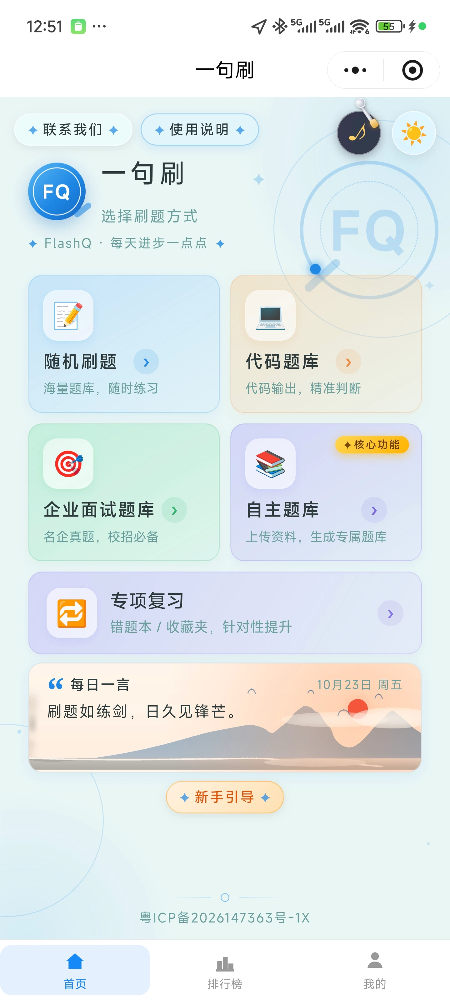
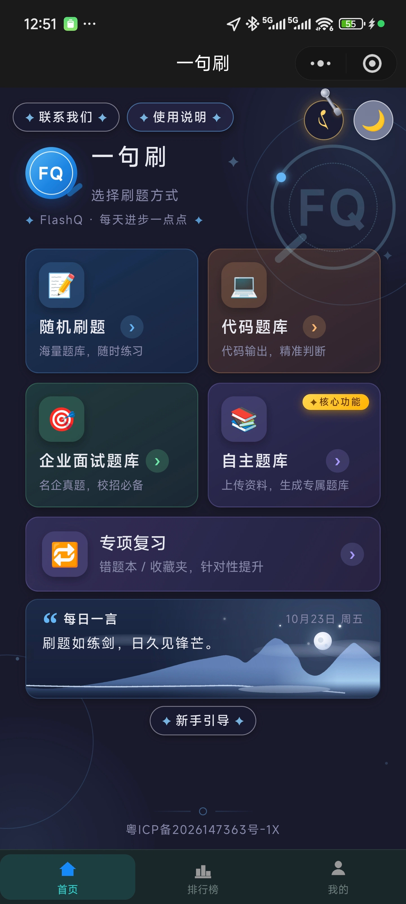

# FlashQ · 一句话刷题

一款面向计算机专业学生的微信小程序刷题工具，支持刷题、错题本、收藏、排行榜、学习报告热力图、AI 出题与 OCR 导入。

<p align="center">
  
  
</p>

## 技术栈

**前端**
- 微信小程序（原生 WXML / WXSS / JS）
- 自定义 tabBar、页面路由、本地缓存

**后端**
- Spring Boot 3 + MyBatis
- MySQL
- 腾讯云 Ubuntu 22.04 + Nginx 反向代理 + HTTPS
- PaddleOCR（Python Flask 服务）
- DeepSeek API（AI 出题）

## 目录结构

```
FlashQ-miniprogram/
├── FlashQ/                      # 后端 Spring Boot 项目
│   ├── src/main/java/com/flashq/
│   │   ├── controller/          # 接口层
│   │   ├── service/             # 业务逻辑
│   │   ├── mapper/              # 数据访问
│   │   ├── entity/              # 数据实体
│   │   └── config/              # 配置类
│   └── src/main/resources/
│       └── application.yaml      # 配置（敏感项走环境变量）
│
└── wx-project/
    └── yijushua/                # 微信小程序前端
        ├── pages/               # 页面
        ├── components/          # 组件
        ├── utils/               # 工具函数
        └── app.js / app.json     # 小程序入口
```

## 核心功能

- **刷题模式**：按科目/知识点随机出题，支持顺序与乱序
- **错题本**：自动收录答错题目，支持重练
- **收藏夹**：收藏题目，分类管理
- **排行榜**：按刷题量与正确率排名，点赞互动
- **学习报告**：热力图展示刷题频率，连续打卡统计
- **AI 出题**：上传课件/PDF，AI 自动生成"一句话"题目
- **OCR 识别**：拍照/上传图片，PaddleOCR 提取文字后出题
- **自定义题库**：用户自建分类与题目

## 本地开发

### 前端
1. 用微信开发者工具打开 `wx-project/yijushua/`
2. 填入自己的 AppID
3. 修改 `utils/api.js` 里的后端接口地址

### 后端
1. 创建 MySQL 数据库，执行 `FlashQ/src/main/resources/` 下的 migration SQL
2. 配置环境变量：
   - `DB_PASSWORD`：数据库密码
   - `AI_API_KEY`：DeepSeek API Key
   - `WX_APP_SECRET`：微信小程序 AppSecret
3. 运行 `FlashQApplication.java`

## 部署

- 后端打包为 jar，部署在腾讯云 Ubuntu
- Nginx 反向代理 `api.flashq.site` → 本地 8080
- PaddleOCR 服务监听 8866 端口
- HTTPS 证书已配置

## 开源协议

暂未指定 License，保留所有权利。
